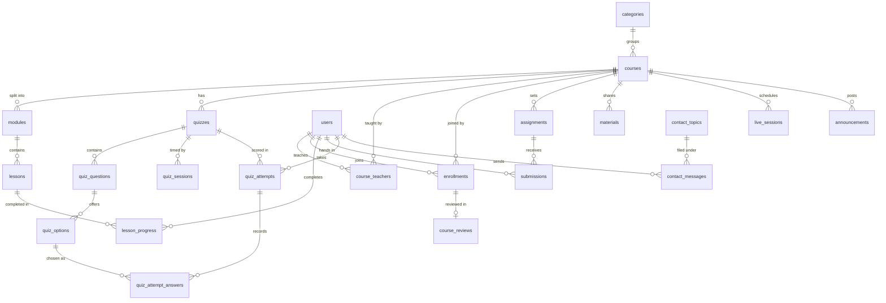

# Coursework data model

Course content (13 courses, 228 lessons, 39 built-in quizzes, 293 questions) is hardcoded in `src/data/`, while everything people do is already in 14 MySQL tables keyed to courses by a text slug. This document lists where every piece of displayed content comes from today, then proposes a relational model that moves the course catalog into MySQL and replaces the slug and text-key links with real foreign keys.

Status: proposal. The app still runs on the current schema. [`database/schema.sql`](../database/schema.sql) builds this model in a new, empty database (`mysql -u root -p learning_platform < database/schema.sql`), and [`database/seed.sql`](../database/seed.sql) fills it with mock data (all 13 courses, 52 modules, 228 lessons, 5 instructors, 20 students, enrollments, progress, quiz attempts and reviews).

## 1. Pages and what they display

Source key: **data** = `src/data/courses.js` and `src/data/course-content/*.js`; **API** = the Express server under `/api`; **hardcoded** = constants or copy inside the component.

### Public pages

| Route | Component | Content shown | Source |
| --- | --- | --- | --- |
| `/` (guests) | `LandingPage.jsx` | Hero, stat strip (courses, lessons, quizzes), 3 featured course cards, topic strip, 6 features, full catalog, 3 "how it works" steps, teacher pitch, 3 FAQs, footer | Counts, cards, topics, catalog: data. Everything else: hardcoded |
| `/help` | `HelpPage.jsx` | FAQ accordion: 3 sections, 11 questions | Hardcoded |
| `/contact` | `ContactPage.jsx` | Contact form with 4 topics | Topics hardcoded; sends to API `POST /contact` |
| `/login`, `/signup` | `LoginPage.jsx`, `SignupPage.jsx`, `AuthForm.jsx` | Form titles and short copy | Hardcoded copy; API `/auth/*` |

### Course pages (any logged-in user)

| Route | Component | Content shown | Source |
| --- | --- | --- | --- |
| `/courses` | `CatalogPage.jsx`, `CourseCard.jsx` | "N courses. N lessons. N quizzes." and a card per course (image or tag on colour, tag, title, description, counts) | Data |
| `/course/:slug` | `CoursePage.jsx` | Tag, title, description; every lesson (video if any, body, code sample, follow-up text); built-in quizzes; join panel naming the teachers; lesson ticks | Course and lessons: data. Teachers, enrollment, progress: API `/learn/courses/:slug` |
| `/course/:slug/quiz/:quizId` | `QuizPage.jsx` | Built-in quiz questions, options, explanations, score | Data; score saved to API |
| Header search (Ctrl+K) | `SearchDialog.jsx`, `lib/search.js` | Matching courses, lessons and quizzes | Index built from data at load time |

### Student area (`/my-learning`)

| Route | Component | Content shown | Source |
| --- | --- | --- | --- |
| `/my-learning` | `LearnLayout.jsx`, `LearnDashboard.jsx` | Joined courses, stats, continue-learning progress, deadlines, live classes, announcements, recent grades | API `/learn/dashboard`, `/learn/enrollments`; course titles, images and lesson counts from data |
| `/my-learning/courses/:slug` | `LearnCourse.jsx`, `SubmitAssignment.jsx`, `DeadlineStatus.jsx` | "Taught by", lesson checklist, built-in quiz best scores, live classes, announcements, quizzes, tests, assignments, videos, materials | API `/learn/courses/:slug`; lessons and built-in quizzes from data |
| `/my-learning/quizzes/:id` | `ClassQuiz.jsx` | Teacher quiz or timed test, results | API `/learn/quizzes/:id` |

### Teacher area (`/teach`, teachers and admins)

| Route | Component | Content shown | Source |
| --- | --- | --- | --- |
| `/teach` | `TeachLayout.jsx`, `TeachDashboard.jsx` | Taught courses, totals, upcoming classes, due assignments, recent submissions | API `/teach/overview`; titles from data |
| `/teach/courses/:slug` | `TeachCourse.jsx` and its sections: `SessionsTab`, `GoLive`, `AnnouncementsTab`, `QuizzesTab`, `AiAssistantTab`, `AssignmentsTab`, `MaterialsTab`, `StudentsTab` | Everything the teacher manages for one course | API `/teach/courses/:slug` and the `/teach/*` write endpoints; lesson titles from data |
| `/teach/courses/:slug/student-view` | `LearnCourse.jsx` (preview) | What an enrolled student sees, read-only | API `/teach/courses/:slug/student-view` |

### Admin area (`/admin`)

| Route | Component | Content shown | Source |
| --- | --- | --- | --- |
| `/admin` | `AdminOverview.jsx` | User and message stats; content totals (courses, lessons, quizzes, videos) | API `/admin/stats`; content totals from data |
| `/admin/users` | `AdminUsers.jsx` | Users list, roles, password resets | API `/admin/users` |
| `/admin/messages` | `AdminMessages.jsx` | Contact messages | API `/admin/messages` |
| `/admin/content` | `AdminContent.jsx` | Per course: lessons, quizzes, questions, videos, image, teachers, students | Counts from data; teachers and students from API `/admin/course-teachers` |

Instructors appear only as names from the API (`course_teachers` joined to `users`). No component hardcodes an instructor name, bio or photo, and the course data has no instructor field.

## 2. Hardcoded content

### Course catalog (`src/data/`)

All 13 course files have the same shape, with no optional fields:

```text
Course   { slug, tag, title, image, color, description, lessons[], quizzes[] }
Lesson   { title, video?, body, code, after }          // video: a path under public/videos/
Quiz     { id, title, description, questions[] }       // description starts "Lessons 1–6: …"
Question { id, prompt, options[], correct, explanation } // always 4 options, ids a–d
Option   { id, text }
```

| What | Count | Notes |
| --- | --- | --- |
| Courses | 13 | 9 distinct tags; every course has an image in `public/images/` |
| Lessons | 228 | 15–20 per course; identified only by their position; 6 have a video |
| Built-in quizzes | 39 | 3 per course, each covering a run of lessons |
| Questions / options | 293 / 1,172 | `correct` is an option id |

Lesson videos are files under `public/videos/`. Only Web Design lessons 1–6 have one so far, and `AdminOverview` and `AdminContent` count them.

### Site copy and settings

| Constant | Location | Holds | Recommendation |
| --- | --- | --- | --- |
| `features` | `LandingPage.jsx:25` | 6 feature cards | Database, as `site_blocks` (optional) |
| `steps` | `LandingPage.jsx:58` | 3 "how it works" steps | Database, as `site_blocks` (optional) |
| `faqs` | `LandingPage.jsx:64` | 3 landing FAQs | Database, `faq_entries` |
| Teacher bullets, hero, CTA, footer copy | `LandingPage.jsx:86–312` | Marketing text | Keep in code until someone needs to edit it without a deploy |
| `sections` | `HelpPage.jsx:8` | 11 help FAQs in 3 sections | Database, `faq_entries` |
| `topics` | `ContactPage.jsx:11` | 4 contact topics | Database, `contact_topics` |
| `CATEGORIES`, `TONES` | `lib/announcements.js:6, 55` | 7 announcement categories with icons and colours | Keep in code; the database keeps the ENUM |
| `ROLE_LABELS`, `HOME_PATHS` | `lib/roles.js:2, 9` | Role names and landing pages | Keep in code |
| Tabs, section lists, status chips, icons | `LearnCourse.jsx:15`, `TeachCourse.jsx:31`, `AdminMessages.jsx:8`, `DeadlineStatus.jsx:2`, `SearchDialog.jsx:7` | UI structure | Keep in code |
| Example searches | `SearchDialog.jsx:102` | 4 sample queries | Keep in code |
| Limits and defaults | `SubmitAssignment.jsx:43` (25 MB), `MaterialsTab.jsx:51` (500 MB), `SessionsTab.jsx:15` (60 min), `QuizzesTab.jsx:124–126` (30 min, 1 attempt), `AssignmentsTab.jsx:100` (100 points) | Numbers also enforced by the server | Keep in code, shared with the server |

There are no hardcoded marketing figures (learner counts, ratings, prices, durations); every number on the landing page is computed from the data.

## 3. Proposed model

### Principles

- **Courses live in the database.** Courses, lessons and built-in quizzes become rows, so admins and teachers can edit them without a deploy and every table can reference them by key.
- **Integer keys, slugs for URLs.** Every table references `courses.id`, `lessons.id` and `quizzes.id`; `courses.slug` and `quizzes.slug` stay unique for the existing URLs.
- **One quiz system.** Built-in quizzes and teacher quizzes and tests share `quizzes`, with `origin` telling them apart, so results, attempts and dashboards use one code path.
- **Questions as rows, not JSON.** Answers point at option rows, so a result stays correct even if a quiz is edited later.
- **Keep what works.** `users`, `submissions`, `quiz_sessions` and `contact_messages` stay almost as they are.

All tables use InnoDB and `utf8mb4`. Times are `DATETIME` in whole seconds, as today.

### Diagram



### Course catalog (new)

**categories** — the course tags ("Design", "Backend", …)

| Column | Type | Key / constraint | Notes |
| --- | --- | --- | --- |
| `id` | INT AUTO_INCREMENT | PK | |
| `name` | VARCHAR(60) | UNIQUE, NOT NULL | Shown on cards |
| `position` | INT | NOT NULL DEFAULT 0 | Order of the landing-page topic strip |

**courses**

| Column | Type | Key / constraint | Notes |
| --- | --- | --- | --- |
| `id` | INT AUTO_INCREMENT | PK | |
| `slug` | VARCHAR(100) | UNIQUE, NOT NULL | URL `/course/<slug>`; never renamed once published |
| `category_id` | INT | FK → `categories.id`, ON DELETE RESTRICT | Replaces `tag` |
| `title` | VARCHAR(200) | NOT NULL | |
| `description` | VARCHAR(500) | NOT NULL | Card and course-page lead |
| `image_url` | VARCHAR(500) | NULL | Today a path under `public/images/`; NULL shows the category on `color` |
| `color` | VARCHAR(40) | NOT NULL | Tailwind class, e.g. `bg-blue-400` |
| `position` | INT | NOT NULL DEFAULT 0 | Catalog order (today: order in `courses.js`) |
| `status` | ENUM('draft','published','archived') | NOT NULL DEFAULT 'draft' | Only published courses show in the catalog |
| `created_at`, `updated_at` | DATETIME | NOT NULL | |

**modules** — a course is split into modules (3–5 in the mock data), each holding a run of lessons

| Column | Type | Key / constraint | Notes |
| --- | --- | --- | --- |
| `id` | INT AUTO_INCREMENT | PK; also UNIQUE (`id`, `course_id`) | The pair is what `lessons` points at |
| `course_id` | INT | FK → `courses.id`, ON DELETE CASCADE | |
| `position` | INT | NOT NULL; UNIQUE (`course_id`, `position`) | 1-based order |
| `title` | VARCHAR(200) | NOT NULL | |
| `summary` | VARCHAR(500) | NULL | |
| `created_at`, `updated_at` | DATETIME | NOT NULL | |

**lessons**

| Column | Type | Key / constraint | Notes |
| --- | --- | --- | --- |
| `id` | INT AUTO_INCREMENT | PK | Stable id; progress points here, not at a position |
| `course_id` | INT | FK → `courses.id`, ON DELETE CASCADE | |
| `module_id` | INT | FK (`module_id`, `course_id`) → `modules` (`id`, `course_id`), ON DELETE CASCADE | The composite key stops a lesson pointing at another course's module |
| `position` | INT | NOT NULL; UNIQUE (`course_id`, `position`) | 1-based across the whole course, so `#lesson-<n>` links and "Lessons 1–6" ranges keep working; reordering changes only this |
| `title` | VARCHAR(200) | NOT NULL | |
| `body` | TEXT | NOT NULL | |
| `code` | TEXT | NULL | Code sample |
| `after_text` | TEXT | NULL | Today's `after` field (renamed: `after` reads badly as a column) |
| `video_url` | VARCHAR(500) | NULL | Lesson video; makes the admin video counts real |
| `created_at`, `updated_at` | DATETIME | NOT NULL | |

### Quizzes and tests (replaces `class_quizzes` and the built-in quiz data)

**quizzes**

| Column | Type | Key / constraint | Notes |
| --- | --- | --- | --- |
| `id` | INT AUTO_INCREMENT | PK | |
| `course_id` | INT | FK → `courses.id`, ON DELETE CASCADE | |
| `origin` | ENUM('catalog','teacher') | NOT NULL | `catalog` = today's built-in quizzes |
| `slug` | VARCHAR(100) | NULL; UNIQUE (`course_id`, `slug`) | Catalog quizzes keep their URL `/course/<slug>/quiz/<slug>` |
| `kind` | ENUM('quiz','test') | NOT NULL DEFAULT 'quiz' | |
| `title` | VARCHAR(200) | NOT NULL | |
| `description` | TEXT | NULL | |
| `first_lesson_id`, `last_lesson_id` | INT | FK → `lessons.id`, ON DELETE SET NULL; NULL | The lesson range a catalog quiz covers (today parsed from "Lessons 1–6") |
| `published` | BOOLEAN | NOT NULL DEFAULT FALSE | |
| `due_at` | DATETIME | NULL | |
| `time_limit_min` | INT | NULL | Tests only |
| `max_attempts` | INT | NULL | NULL = unlimited |
| `created_by` | INT | FK → `users.id`, ON DELETE SET NULL | NULL for catalog quizzes |
| `created_at`, `updated_at` | DATETIME | NOT NULL | |

**quiz_questions**

| Column | Type | Key / constraint | Notes |
| --- | --- | --- | --- |
| `id` | INT AUTO_INCREMENT | PK | |
| `quiz_id` | INT | FK → `quizzes.id`, ON DELETE CASCADE | |
| `position` | INT | NOT NULL; UNIQUE (`quiz_id`, `position`) | |
| `prompt` | TEXT | NOT NULL | |
| `explanation` | TEXT | NULL | |

**quiz_options**

| Column | Type | Key / constraint | Notes |
| --- | --- | --- | --- |
| `id` | INT AUTO_INCREMENT | PK | |
| `question_id` | INT | FK → `quiz_questions.id`, ON DELETE CASCADE | |
| `position` | TINYINT | NOT NULL; UNIQUE (`question_id`, `position`) | Shown as a, b, c… |
| `text` | VARCHAR(500) | NOT NULL | |
| `is_correct` | BOOLEAN | NOT NULL DEFAULT FALSE | Exactly one per question, checked by the server |

**quiz_attempts** (changed: `quiz_key` text becomes `quiz_id`)

| Column | Type | Key / constraint | Notes |
| --- | --- | --- | --- |
| `id` | INT AUTO_INCREMENT | PK | |
| `quiz_id` | INT | FK → `quizzes.id`, ON DELETE CASCADE | |
| `student_id` | INT | FK → `users.id`, ON DELETE CASCADE | INDEX (`student_id`, `quiz_id`) |
| `session_id` | INT | FK → `quiz_sessions.id`, ON DELETE SET NULL; NULL | Links a test result to its timed start |
| `score`, `total` | INT | NOT NULL | Kept so dashboards don't recount |
| `created_at` | DATETIME | NOT NULL | |

**quiz_attempt_answers** (new; replaces the `answers` JSON)

| Column | Type | Key / constraint | Notes |
| --- | --- | --- | --- |
| `attempt_id` | INT | PK part; FK → `quiz_attempts.id`, ON DELETE CASCADE | |
| `question_id` | INT | PK part; FK → `quiz_questions.id`, ON DELETE CASCADE | |
| `option_id` | INT | FK → `quiz_options.id`, ON DELETE SET NULL; NULL | NULL = left blank |

Catalog quizzes are graded in the browser today and only send a score. They can keep doing that (no answer rows) or move to server grading like teacher quizzes; the schema supports both.

**quiz_sessions** (unchanged): `id` PK, `quiz_id` FK → `quizzes.id`, `student_id` FK → `users.id`, `started_at`, `submitted_at` NULL.

### People and access

**users** (unchanged, plus two optional profile columns for instructor pages)

| Column | Type | Key / constraint | Notes |
| --- | --- | --- | --- |
| `id` | INT AUTO_INCREMENT | PK | |
| `name` | VARCHAR(100) | NOT NULL | |
| `email` | VARCHAR(255) | UNIQUE, NOT NULL | |
| `password_hash` | VARCHAR(255) | NOT NULL | bcrypt |
| `role` | ENUM('student','teacher','admin') | NOT NULL DEFAULT 'student' | |
| `bio` | VARCHAR(500) | NULL | New, optional: shown with "Taught by" |
| `avatar_url` | VARCHAR(500) | NULL | New, optional |
| `created_at` | DATETIME | NOT NULL | |

**course_teachers**, **enrollments** (changed: `course_slug` becomes `course_id`)

| Table | Columns | Keys |
| --- | --- | --- |
| `course_teachers` | `course_id` INT, `teacher_id` INT, `assigned_at` DATETIME | PK (`course_id`, `teacher_id`); FKs → `courses.id`, `users.id`, both ON DELETE CASCADE |
| `enrollments` | `student_id` INT, `course_id` INT, `enrolled_at` DATETIME | PK (`student_id`, `course_id`); INDEX (`course_id`); FKs CASCADE |

**course_reviews** (new) — one rating per student per course

| Column | Type | Key / constraint | Notes |
| --- | --- | --- | --- |
| `id` | INT AUTO_INCREMENT | PK | |
| `course_id`, `student_id` | INT | UNIQUE (`course_id`, `student_id`); FK (`student_id`, `course_id`) → `enrollments`, ON DELETE CASCADE | Only students who joined can review; leaving the course removes the review |
| `rating` | TINYINT | NOT NULL; CHECK 1–5 | |
| `comment` | TEXT | NULL | A rating alone is allowed |
| `created_at`, `updated_at` | DATETIME | NOT NULL | |

**lesson_progress** (changed: points at the lesson, not its position)

| Column | Type | Key / constraint |
| --- | --- | --- |
| `student_id` | INT | PK part; FK → `users.id`, ON DELETE CASCADE |
| `lesson_id` | INT | PK part; FK → `lessons.id`, ON DELETE CASCADE |
| `completed_at` | DATETIME | NOT NULL |

### Classroom content

These tables keep their columns from migrations 003–005; the change is `course_slug VARCHAR(100)` becoming `course_id INT` with FK → `courses.id`, ON DELETE CASCADE.

| Table | Columns (besides `id`, `course_id`, `created_by` FK → `users.id` ON DELETE SET NULL, `created_at`) |
| --- | --- |
| `materials` | `title` VARCHAR(200), `description` TEXT, `kind` ENUM('file','video','link'), `file_name`, `original_name` VARCHAR(255), `mime_type` VARCHAR(150), `size_bytes` BIGINT, `url` VARCHAR(1000) |
| `assignments` | `title` VARCHAR(200), `instructions` TEXT, `due_at` DATETIME, `max_points` INT DEFAULT 100 |
| `live_sessions` | `title` VARCHAR(200), `description` TEXT, `starts_at` DATETIME, `duration_min` INT DEFAULT 60, `meeting_url` VARCHAR(1000); INDEX (`course_id`, `starts_at`) |
| `announcements` | `title` VARCHAR(200), `body` TEXT, `publish_at` DATETIME NULL (NULL = draft), `category` ENUM(7 values), `pinned` BOOLEAN, plus the related-item keys below |

**announcements: related item.** Today `related_type` + `related_id` is a link MySQL can't check. Replace it with four nullable foreign keys, at most one set. The server has to enforce "at most one": MySQL rejects a `CHECK` on columns whose foreign key uses ON DELETE SET NULL (error 3823).

| Column | Type | Key |
| --- | --- | --- |
| `related_assignment_id` | INT NULL | FK → `assignments.id`, ON DELETE SET NULL |
| `related_quiz_id` | INT NULL | FK → `quizzes.id`, ON DELETE SET NULL |
| `related_session_id` | INT NULL | FK → `live_sessions.id`, ON DELETE SET NULL |
| `related_material_id` | INT NULL | FK → `materials.id`, ON DELETE SET NULL |

**submissions** (unchanged): `id` PK; `assignment_id` FK → `assignments.id` CASCADE; `student_id` FK → `users.id` CASCADE; UNIQUE (`assignment_id`, `student_id`); `text_answer` TEXT; file columns as in `materials`; `submitted_at`; `grade` INT NULL; `feedback` TEXT NULL; `graded_at` DATETIME NULL; `graded_by` FK → `users.id` SET NULL.

### Site content (optional, phase 3)

**contact_topics**: `id` INT PK; `label` VARCHAR(100) UNIQUE; `position` INT; `active` BOOLEAN. `contact_messages.topic` becomes `topic_id` FK → `contact_topics.id`, ON DELETE RESTRICT.

**contact_messages** (otherwise unchanged): `id` PK; `user_id` FK → `users.id` SET NULL, NULL for guests; `name`, `email`, `message`; `handled` BOOLEAN; `created_at`.

**faq_entries** — one table for the Help page and the landing-page FAQ

| Column | Type | Key / constraint | Notes |
| --- | --- | --- | --- |
| `id` | INT AUTO_INCREMENT | PK | |
| `page` | ENUM('help','landing') | NOT NULL | |
| `section` | VARCHAR(100) | NULL | Help sections: Getting started, Courses and quizzes, Your account |
| `position` | INT | NOT NULL | |
| `question` | VARCHAR(300) | NOT NULL | |
| `answer` | TEXT | NOT NULL | Some help answers describe server rules (7-day login, admin-only resets); edit them when those change |

**site_blocks** — landing-page feature cards and "how it works" steps: `id` PK; `area` ENUM('feature','step'); `position` INT; `icon` VARCHAR(40) (a lucide icon name); `title` VARCHAR(120); `body` VARCHAR(500).

### How each known gap is closed

| Gap today | Fixed by |
| --- | --- |
| `course_slug` is never checked, so renaming a course orphans its data | `course_id` foreign keys everywhere; slug only in `courses` |
| `lesson_index` is a position, so reordering lessons shifts progress | `lesson_progress.lesson_id` |
| `quiz_key` text (`builtin:…`, `class:…`) detaches results when a quiz id changes | `quiz_attempts.quiz_id` |
| Announcement links can point at deleted items | Four nullable FKs with ON DELETE SET NULL |
| `answers` JSON stores choices only, so editing a quiz changes old results | `quiz_attempt_answers` pointing at option rows; block deleting options that have answers |
| Lesson videos live only in code and `public/videos/`, so adding one needs a deploy | `lessons.video_url` |

## 4. Migration path

1. **Catalog tables.** Add `categories`, `courses`, `modules`, `lessons`, `quizzes`, `quiz_questions`, `quiz_options`. A one-off script imports the 13 course files, keeping slugs and quiz ids. The website keeps reading `src/data/` until a read API (`GET /api/courses`, `GET /api/courses/:slug`) replaces `getCourse()`.
2. **Switch keys.** Add `course_id` beside `course_slug` and `lesson_id` beside `lesson_index`, backfill from the slugs and positions, then drop the old columns. Move `class_quizzes` rows into `quizzes` (`origin = 'teacher'`) and `quiz_key` into `quiz_id`.
3. **Site content.** Optional: move contact topics and FAQs into the database once there's an admin screen to edit them.

Each step is a numbered file in `coursework-server/migrations/`. Update `scripts/seed-demo.js` alongside each one.

## 5. Open questions

- Should teachers edit catalog lessons, or only admins? This decides whether `course_teachers` grants edit rights on `lessons`.
- Should catalog quizzes be graded on the server like teacher quizzes? Doing so would hide the answers from the browser and fill `quiz_attempt_answers`.
- Should a quiz be locked once someone has attempted it, or should edits create a new version?
- Should lesson videos be a single URL per lesson (as proposed), or a separate table, to allow several videos or uploaded files per lesson?
